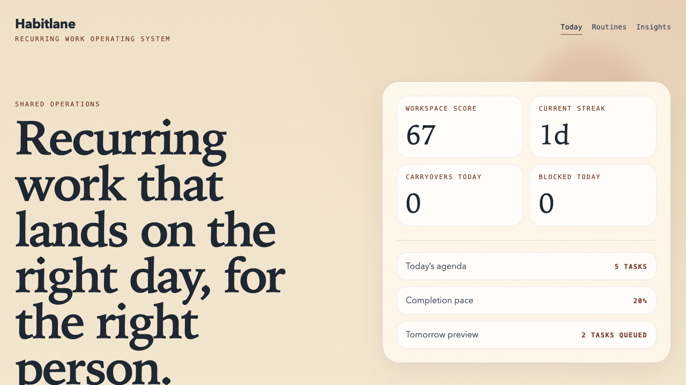

# Habitlane

`habitlane` is a recurring work operating system for homes and small teams that need responsibilities to materialize on the right day, for the right person, without constant manual planning.

It is designed as a standalone product: a believable demo workspace, a teachable recurring-work engine, and a mobile-friendly interface that shows why recurring operations need more than a generic to-do list.



Production capture of the flagship daily view using the committed fictional workspace.

## Status

This repo is now at the launch-candidate stage.

The current goal is to finish the public launch gate:
- a clean repo history
- a safe OSS baseline
- a polished demo path
- strong adaptation docs
- CI and verification
- a completed public-safety review

## Product Direction

### Core promise
Turn recurring responsibilities into a reliable daily workflow with schedule awareness, rollover handling, and clear ownership.

### Intended users
- families coordinating recurring home operations
- small teams managing recurring checklists
- operators who need structured recurring work instead of generic task management

### What v1 is meant to include
- recurring routines with multiple frequency types
- schedule-aware daily task generation
- rollover and blocked-work behavior
- clear role separation
- completion and consistency insights
- a believable demo workspace

### What v1 is not meant to include
- private names, schedules, or seeded live-workspace details
- AI recap features
- auth, persistence, or hosted collaboration as a hard dependency
- proprietary integrations or private automation flows

## Quick Start

```bash
npm install
npm run dev
```

Then open `http://localhost:3000`.

Verification commands:

```bash
npm run test
npm run check
```

## Demo Assets

The repo now includes committed demo-safe assets for screenshots and social previews:

- [today view screenshot](demo/habitlane-today-real.png)
- [routine library screenshot](demo/habitlane-routines-real.png)
- [insights screenshot](demo/habitlane-insights-real.png)
- [daily poster](demo/habitlane-daily-poster.svg)
- [social preview](demo/habitlane-social-preview.svg)

These are built from the public-safe product story, not from any live internal workspace.

## Repo Structure

```text
src/app/
  layout.tsx         App metadata
  page.tsx           Daily agenda view
  routines/page.tsx  Routine library
  insights/page.tsx  Completion and consistency view
  globals.css        Visual system and shared styling

src/components/
  app-chrome.tsx     Shared app navigation
  day-strip.tsx      Seven-day operating rhythm strip
  member-lane.tsx    Owner-specific agenda lane

src/lib/
  demo/workspace.ts       Fictional members, routines, and exceptions
  habitlane/date.ts       Date helpers for schedule-aware planning
  habitlane/types.ts      Public-safe domain types
  habitlane/engine.ts     Daily materialization and rollover logic
  habitlane/insights.ts   Completion, carryover, and streak insights
  habitlane/demo.ts       UI-facing snapshot builder

docs/
  architecture.md         System shape and data flow
  domain-model.md         Public-safe roles, lanes, and routine model
  release-readiness.md    Launch gate status
  public-safety-review.md Privacy and exposure review
  roadmap.md              Near-term and later roadmap

demo/
  Poster and social-preview assets

tests/
  Engine and insight unit coverage
```

## Implementation Map

These are the main areas this repo is expected to grow into:

- recurring-work engine
  Materialize daily tasks from reusable routines, schedules, and interval rules.
- rollover system
  Carry unfinished work to the next working day without duplicating tomorrow's base tasks.
- daily agenda UI
  Show what is due today, what rolled forward, and what is blocked.
- routine library
  Make routines, owners, and cadence legible enough to adapt quickly.
- insights layer
  Compute completion pace, streaks, carryovers, and blocked-work pressure.
- demo workspace
  Let someone understand the product with fictional members and routines before they swap in their own.

## Customization Guide

If someone wants to adapt `habitlane` for personal use, the recommended flow is:

1. Start with the fictional demo workspace.
2. Replace the demo members, schedules, and routines with your own neutral dataset.
3. Adjust the recurring-work rules in the engine for your home or team.
4. Tune the insights thresholds to match what "healthy" looks like in your context.
5. Refine the UI around the daily, admin, and insight views you actually use.

Expected customization points:
- member schedules and schedule exceptions
- routine cadence and interval rules
- carryover behavior and duplication rules
- insight thresholds for score, streaks, and carryovers
- visual language and route-level UI

## Known Limitations

- The repo is demo-first. It does not yet persist routines, completions, or schedules to a database.
- There is no authenticated editing surface yet; the routine library is read-only.
- The insight model is intentionally lightweight and opinionated rather than a full analytics product.

## Privacy Model

Safe to expose:
- recurring-work logic
- generic roles
- fictional routines and schedules
- demo completion metrics
- synthetic screenshots and demo assets

Must stay out of the repo:
- real names, emails, usernames, or passwords
- real schedules or private notes
- copied routine text from live systems
- family-specific operational history
- private URLs, secrets, or deploy flows

## For Claude / Codex

This repo is meant to be adaptable with an AI coding agent.

Read these files first:
- `README.md`
- `src/app/page.tsx`
- `src/app/routines/page.tsx`
- `src/app/insights/page.tsx`
- `src/lib/demo/workspace.ts`
- `src/lib/habitlane/types.ts`
- `src/lib/habitlane/engine.ts`
- `src/lib/habitlane/insights.ts`
- `docs/architecture.md`
- `docs/domain-model.md`

Safest places to start changing the repo:
- `src/lib/demo/workspace.ts` for demo members, routines, and schedule exceptions
- `src/lib/habitlane/engine.ts` for generation, rollover, and working-day rules
- `src/lib/habitlane/insights.ts` for score and streak logic
- `src/app/page.tsx` for the daily agenda structure
- `src/app/routines/page.tsx` and `src/app/insights/page.tsx` for supporting views
- `README.md` and `docs/` for the implementation contract

What is intentionally missing right now:
- authentication and persistence
- live editing for routines and schedule exceptions
- external integrations or messaging flows
- any private operating data or deployment assumptions

## OSS Baseline

- License: Apache-2.0
- Security policy: [SECURITY.md](SECURITY.md)
- Contribution guide: [CONTRIBUTING.md](CONTRIBUTING.md)
- Launch review: [docs/release-readiness.md](docs/release-readiness.md)
- Public-safety review: [docs/public-safety-review.md](docs/public-safety-review.md)
- Test coverage: `npm run test`

## Next Steps

- add a lightweight persisted editing mode for routines and completion events
- introduce optional team presets beyond the single flagship demo workspace
- expand the insights surface with weekly trend comparisons and workload balance
- complete the final GitHub settings pass and tag the first release
